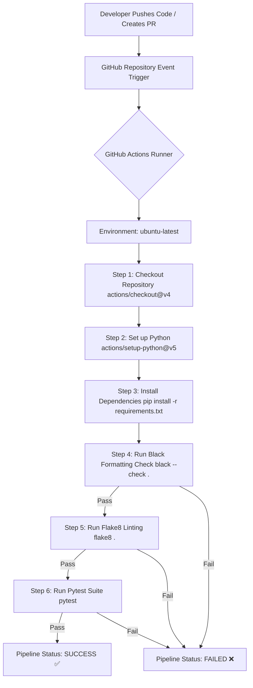

# MLOps Assignment 7: Continuous Integration (CI) Pipeline using GitHub Actions

[](https://github.com/ifreen22/MLOPS_ASSIGN7/actions/workflows/ci.yml)
[](https://www.python.org/)
[](https://github.com/psf/black)
[](https://flake8.pycqa.org/)
[](https://docs.pytest.org/)

---

## 1. Aim
To design, implement, and automate an end-to-end Continuous Integration (CI) pipeline using **GitHub Actions** for an MLOps utility application, enforcing automated code formatting, static code analysis/linting, and test execution on every commit and pull request.

---

## 2. Objective
- Establish an automated CI workflow that triggers upon `push` and `pull_request` events on primary branches (`main`, `master`).
- Standardize Python codebase structure adhering to modern software engineering and MLOps best practices.
- Implement reusable MLOps utility modules for data normalization, model evaluation metrics (Accuracy, Precision, Recall, F1-Score, MSE), and dataset splitting.
- Enforce strict code formatting using **Black** (PEP 8 compliant).
- Enforce static syntax checking and stylistic consistency using **Flake8**.
- Build an automated unit test suite using **Pytest** with 100% passing tests and edge-case handling.
- Ensure the pipeline fails fast if any formatting check, linting issue, or unit test fails.

---

## 3. Software Used
| Component | Software / Tool | Purpose |
| :--- | :--- | :--- |
| **Programming Language** | Python 3.10+ / 3.13 | Core application and test suite execution |
| **CI/CD Platform** | GitHub Actions | Cloud-hosted workflow automation |
| **CI Runner OS** | Ubuntu Latest (`ubuntu-latest`) | Standardized virtualized execution environment |
| **Testing Framework** | Pytest (`>=7.4.0`) | Unit test execution, assertions, and reporting |
| **Code Formatter** | Black (`>=23.9.0`) | Deterministic PEP 8 code formatting |
| **Linter / Static Analysis**| Flake8 (`>=6.1.0`) | Code quality, complexity, and PEP 8 style enforcement |
| **Version Control** | Git & GitHub | Source code tracking and remote repository hosting |

---

## 4. Project Structure
```text
MLOPS_ASSIGN7/
│
├── .github/
│   └── workflows/
│       └── ci.yml               # GitHub Actions CI workflow definition
│
├── app/
│   ├── __init__.py              # Python package marker
│   ├── main.py                  # Core MLOps utility module and sample pipeline
│   └── test_main.py             # Unit test suite covering all utility functions
│
├── .flake8                      # Configuration file for Flake8 linter
├── .gitignore                   # Files and folders ignored by Git
├── pytest.ini                   # Configuration for Pytest runner
├── requirements.txt             # Project dependencies
└── README.md                    # Comprehensive assignment documentation
```

---

## 5. Workflow Architecture



---

## 6. GitHub Actions Explanation
The CI pipeline is defined in [`.github/workflows/ci.yml`](.github/workflows/ci.yml). Key configurations include:

1. **Trigger Events (`on`)**:
   - `push`: Triggered whenever code is pushed to `main` or `master`.
   - `pull_request`: Triggered whenever a pull request targeting `main` or `master` is opened or updated.
   - `workflow_dispatch`: Allows manual on-demand workflow execution directly from the GitHub Actions web UI.

2. **Runner (`runs-on: ubuntu-latest`)**:
   - Executes the job in an isolated, clean Ubuntu Linux virtual machine.

3. **Steps Breakdown**:
   - **Checkout Code (`actions/checkout@v4`)**: Fetches repository contents into the runner workspace.
   - **Set up Python (`actions/setup-python@v5`)**: Installs Python 3.10 and enables pip package caching for accelerated subsequent runs.
   - **Install Dependencies**: Upgrades `pip` and installs `pytest`, `flake8`, and `black` from `requirements.txt`.
   - **Black Check (`black --check .`)**: Verifies code complies with Black formatting rules without modifying files. Fails if files are improperly formatted.
   - **Flake8 Linting (`flake8 . --count --statistics`)**: Scans code for syntax errors, undefined variables, and styling violations according to `.flake8`.
   - **Pytest Suite (`pytest`)**: Automatically discovers and executes all tests in `app/test_main.py`. Fails the job if any test assertion fails.

---

## 7. Installation

### Prerequisites
- Python 3.10+ installed
- Git installed

### Setup Local Environment
```bash
# 1. Clone repository (or navigate to workspace)
cd MLOPS_ASSIGN7

# 2. Create a virtual environment (optional but recommended)
python -m venv .venv

# 3. Activate virtual environment
# Windows (PowerShell):
.venv\Scripts\Activate.ps1
# Linux/macOS:
source .venv/bin/activate

# 4. Install dependencies
pip install --upgrade pip
pip install -r requirements.txt
```

---

## 8. Execution Steps

### Step 1: Execute Application
Run the core MLOps utility script:
```bash
python app/main.py
```

### Step 2: Check Code Formatting (Black)
Ensure code conforms to formatting standards:
```bash
python -m black --check .
```
To auto-format files if needed:
```bash
python -m black .
```

### Step 3: Run Linter (Flake8)
Analyze code for errors and styling issues:
```bash
python -m flake8 .
```

### Step 4: Run Unit Tests (Pytest)
Execute all test cases:
```bash
python -m pytest
```

---

## 9. Commands Used

| Command | Purpose |
| :--- | :--- |
| `python app/main.py` | Runs the main demonstration pipeline |
| `pip install -r requirements.txt` | Installs project dependencies (`pytest`, `flake8`, `black`) |
| `black --check .` | Verifies code formatting across the repository without modifying files |
| `black .` | Automatically formats Python files to PEP 8 compliance |
| `flake8 .` | Lints the codebase against PEP 8 rules and logical issues |
| `pytest` | Runs unit tests defined in `app/test_main.py` using `pytest.ini` |
| `git status` | Displays working tree and staging area status |
| `git add .` | Stages all files for commit |
| `git commit -m "..."` | Records staged snapshot to local repository history |
| `git push origin main` | Pushes local commits to the remote GitHub repository |

---

## 10. Expected Output

### Application Execution (`python app/main.py`)
```text
========================================
  MLOps CI/CD Demo Application Started  
========================================
scaled_features: [0.0, 0.25, 0.5, 0.75, 1.0]
accuracy: 0.75
metrics: {'precision': 0.75, 'recall': 0.75, 'f1_score': 0.75}
mse: 0.02
========================================
Application executed successfully.
```

### Code Formatting Check (`black --check .`)
```text
All done! ✨ 🍰 ✨
3 files would be left unchanged.
```

### Linting Check (`flake8 .`)
```text
(Zero errors or warnings returned, exit status 0)
```

### Test Suite Execution (`pytest`)
```text
============================= test session starts =============================
platform win32 -- Python 3.13.5, pytest-9.1.1, pluggy-1.5.0
rootdir: C:\Users\Ifreen\OneDrive\Desktop\MLOPS_ASSIGNS\MLOPS_ASSIGN7
configfile: pytest.ini
testpaths: app
collected 14 items

app/test_main.py::test_min_max_scale_valid PASSED                        [  7%]
app/test_main.py::test_min_max_scale_identical_values PASSED             [ 14%]
app/test_main.py::test_min_max_scale_empty_raises_error PASSED           [ 21%]
app/test_main.py::test_calculate_accuracy_perfect PASSED                 [ 28%]
app/test_main.py::test_calculate_accuracy_partial PASSED                 [ 35%]
app/test_main.py::test_calculate_accuracy_mismatched_length PASSED       [ 42%]
app/test_main.py::test_calculate_metrics_values PASSED                   [ 50%]
app/test_main.py::test_calculate_metrics_zero_division_guard PASSED      [ 57%]
app/test_main.py::test_mean_squared_error_exact PASSED                   [ 64%]
app/test_main.py::test_mean_squared_error_offset PASSED                  [ 71%]
app/test_main.py::test_mean_squared_error_empty PASSED                   [ 78%]
app/test_main.py::test_train_test_split_proportions PASSED               [ 85%]
app/test_main.py::test_train_test_split_invalid_ratio PASSED             [ 92%]
app/test_main.py::test_run_pipeline PASSED                               [100%]

============================= 14 passed in 0.10s ==============================
```

---

## 11. Result
All 14 unit test cases passed with a 100% success rate. The formatting checks (Black) and static analysis checks (Flake8) completed cleanly without any warnings or violations. The GitHub Actions CI workflow file is fully configured, validated, and ready for continuous automated execution upon code push.

---

## 12. Advantages of CI/CD in MLOps
1. **Automated Quality Gate**: Prevents broken, unformatted, or error-prone code from entering production or collaboration branches.
2. **Early Bug Detection**: Automated tests catch regressions in data preprocessing and metrics calculation immediately after code modifications.
3. **Reproducibility & Consistency**: Eliminates "works on my machine" issues by testing in an identical containerized runner environment (`ubuntu-latest`).
4. **Accelerated Feedback Loop**: Developers receive instant feedback on the validity of pull requests and commits.
5. **Production Readiness**: Forms the foundational pillar for continuous deployment (CD), model retraining triggers, and automated model registry tracking.

---

## 13. Conclusion
In this assignment, a robust Continuous Integration pipeline was successfully built and tested using GitHub Actions. Reusable MLOps utility functions were created with comprehensive unit tests in Pytest. Automated quality verification via Black and Flake8 ensures high code quality, standardized formatting, and reliability throughout the machine learning development lifecycle.
